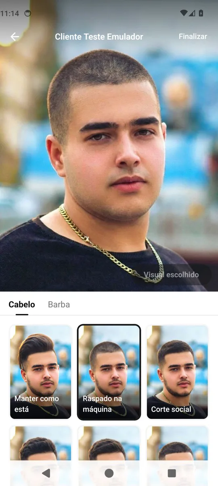
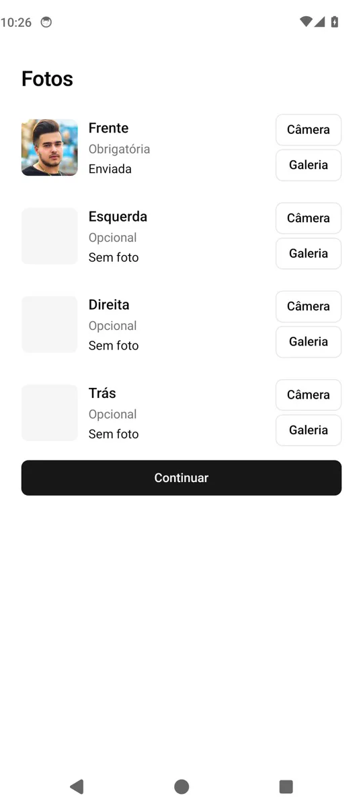
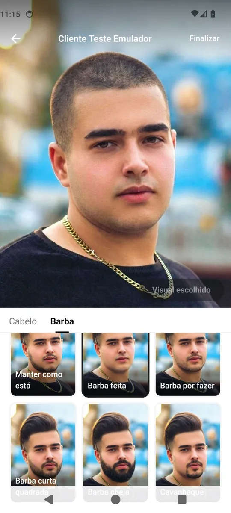
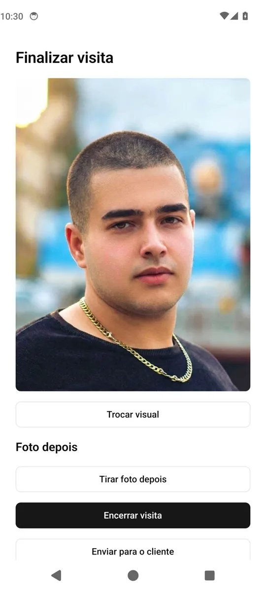
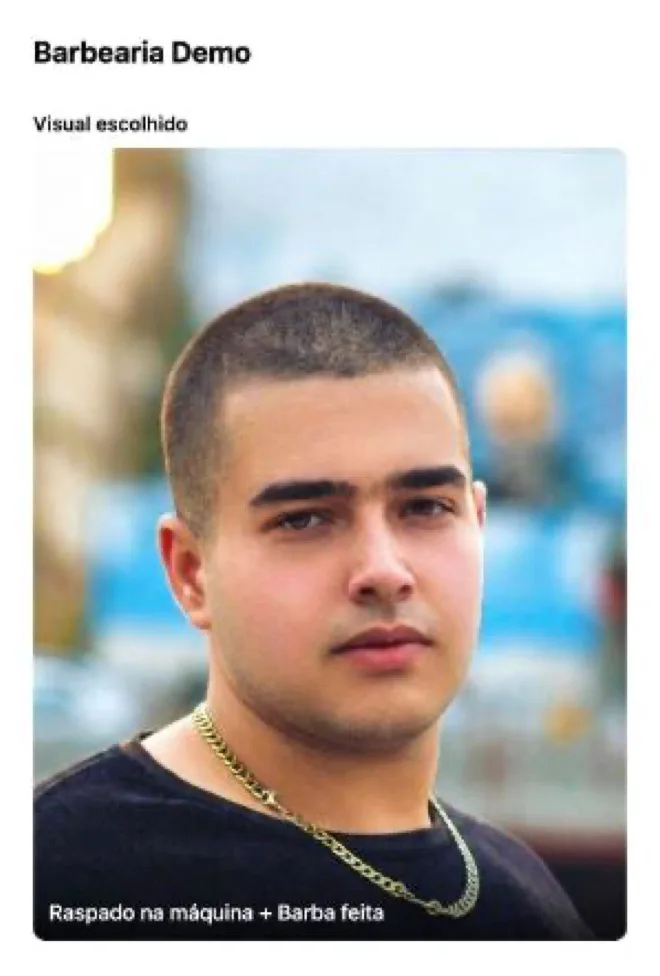
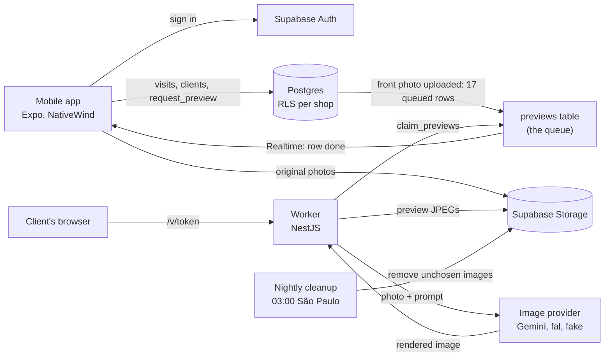
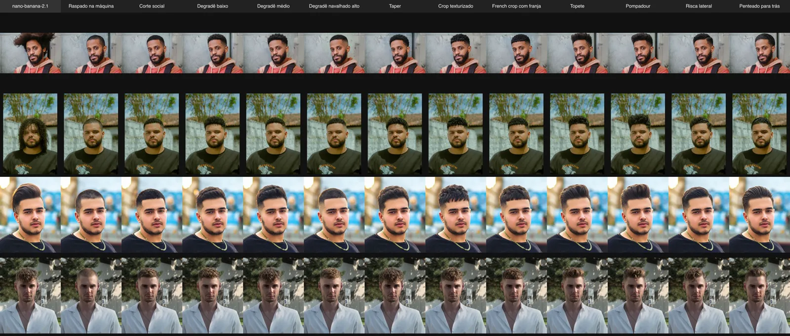
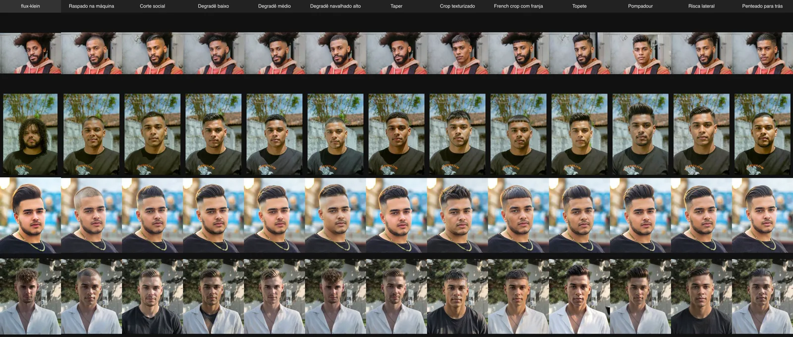

# Barber app (working title, no name yet)

A phone app where a barber photographs the client in the chair and shows them AI previews of hair and beard styles on their own face before cutting.

**Status: work in progress.** Milestone 1 runs as a demo: an Android APK against a cloud Supabase project and a worker at https://barber.kevinshibuya.com, with the M2 owner dashboard and offline tolerance built on top. The CRM with bookings and retention, an iOS build, a store listing, a name and the region-composited render pipeline do not exist yet.

<p align="center">
  
</p>

## What it is

A client in the chair says "something shorter, maybe a fade?". The client cannot picture it, the barber cannot show it, and the phone comes out for an image search of someone else's head. The try-on apps that exist are built for one person at home with a selfie and a subscription. None is fast enough for the chair, keeps the shop's clients, or remembers what was cut last time.

This app is for barbers in Brazil, in shops the owner signs up by hand, and it speaks Portuguese. The barber photographs the client from up to four angles. The moment the front photo is uploaded, a worker renders that client in all 12 hair styles and 5 beard styles of the catalog, so the picker fills in while the barber is still talking. The barber chooses a look with the client, takes an after photo, and sends the client a link to a page with their previews.

Every visit keeps its photos, the chosen look and the after photo. That history is where the CRM grows from.

## What works today

- A barber signs in, finds or creates a client and opens their visit history. Evidence: `apps/mobile/tests/login.test.tsx`, `client.test.tsx`, `home.test.tsx`.
- A visit records the client's consent, then takes up to four photos. Only the front one is required. Evidence: `new-visit.test.tsx`, `photo-slots.test.tsx`, screenshots below.
- Uploading the front photo queues 17 previews, and the picker's tiles fill in as they finish. Evidence: `packages/shared/tests/queue.test.ts`, `apps/worker/test/queue.test.ts`, `picker-grid.test.tsx`.
- A hair plus beard combination and the left, right and back angles render on demand. Evidence: `picker-preview.test.tsx`, `picker-angles.test.tsx`.
- The barber chooses a look, takes the after photo, closes the visit and shares a client page link. Evidence: `finish.test.tsx`, `apps/worker/test/client-page.test.ts`.
- The shop owner sees six numbers for the week and month. Evidence: `dashboard.test.tsx`, `packages/shared/tests/dashboard-views.test.ts`.
- Uploads survive a dropped connection and an app restart; recent clients and visits read from cache offline. Evidence: `upload-queue.test.ts`, `offline-screens.test.tsx`, `cache.test.ts`.
- A nightly job removes the images of unchosen previews older than seven days and clears expired share links. Evidence: `apps/worker/test/cleanup.test.ts`.
- Each barber reads and writes only their own shop's rows and files. Evidence: `packages/shared/tests/tenancy.test.ts`, `storage.test.ts`.

### Next

- Render each style from the original photo and keep only its hair or beard region, so no preview changes the face. Decided in [ADR 0001](docs/adr/0001-composite-regions-over-the-original.md).
- A drift gate that rejects any render whose face is not the same person in the same place.
- Every hair plus beard pair assembled from two finished renders, so no tap waits for a render.
- One design language across the app and the client page, from references the owner approves.
- A stock model the catalog previews on when a client declines photos.

## Look

Screens from the 2026-10-23 emulator walkthrough of the release APK, against the cloud project. The client is a Pexels stock photo. The interface is in Brazilian Portuguese.

<table>
  <tr>
    <td width="33%"></td>
    <td width="33%"></td>
    <td width="33%"></td>
  </tr>
  <tr>
    <td>Consent comes first: Tirar fotos waits for the checkbox.</td>
    <td>Four angles, front required. The front upload starts the 17 renders.</td>
    <td>Beard tab. The same client in each beard style, captioned in Portuguese.</td>
  </tr>
  <tr>
    <td></td>
    <td></td>
    <td></td>
  </tr>
  <tr>
    <td>Finish: the chosen look, the after photo, and the link for the client.</td>
    <td>The client page the link opens: a server-rendered page with no script.</td>
    <td>Owner dashboard, on an empty month.</td>
  </tr>
</table>

## Run it

| Fact | Value |
|---|---|
| Runtime | Node 22.12 or newer (`engines` in `package.json`) |
| Package manager | pnpm 11.5.2 (`packageManager` in `package.json`) |
| Operating system | macOS or Linux with Bash; the database scripts use `/tmp` for their lock |
| External services | Docker and the Supabase CLI, for a local Supabase; nothing in the cloud |
| Paid keys needed | No. The fake image provider renders a fixed image for free |
| Ports | 56320 to 56329 (local Supabase: API 56321, Postgres 56322, Studio 56323), 3000 (worker), 8081 (Expo) |
| Time to first run | About 2 minutes for `pnpm install`, plus the Supabase image download on first start |

1. Clone and install.

```sh
git clone https://github.com/kevinshibuya/barber-app.git && cd barber-app && pnpm install
```

Expect: pnpm ends with `Done in` and a time.

2. Start the local Supabase and apply the migrations. The full stack did not pass its health checks in a Docker VM with 1.5 GB of memory; give Docker more, or start it first without the services the tests do not use: `supabase start -x studio,logflare,vector,edge-runtime,imgproxy,mailpit,postgres-meta`.

```sh
scripts/db-up.sh
```

Expect: a last JSON line with `"message":"Migrations applied"`. Seen here after the reduced start; the full start timed out on its health checks.

3. Run every package's tests against it.

```sh
scripts/db-test.sh '@barber/*' test
```

Expect: each package prints `Tests:` with no failures. Not run here to a pass: on a freshly started local Supabase, 35 of the 42 `@barber/shared` tests failed with `Email logins are disabled`, because `[auth.email] enable_signup = false` in `supabase/config.toml` turns the email provider off.

4. Start the worker on the fake provider. It reads its variables from the environment, so load the file first.

```sh
cp apps/worker/.env.example apps/worker/.env   # then paste SUPABASE_SERVICE_ROLE_KEY from `supabase status`
set -a; . apps/worker/.env; set +a; pnpm --filter @barber/worker start
```

Expect: `curl http://127.0.0.1:3000/health` answers `{"status":"ok"}`. Not run here: the machine was under load.

5. Start the app in Expo Go, pointed at the local stack.

```sh
cp apps/mobile/.env.example apps/mobile/.env   # then paste EXPO_PUBLIC_SUPABASE_ANON_KEY from `supabase status`
cd apps/mobile && npx expo start --go
```

Expect: Metro prints a QR code; the app opens on the login screen. Sign-up is off, so create a shop and its logins with `pnpm --filter @barber/shared run provision`, with the local URL and service role key exported. Step 1.7 of `docs/release.md` shows the flags. Not run here: the machine was under load. The local login will hit the same email-provider setting as step 3.

**Paid path, not for a first run.** Any `IMAGE_PROVIDER` other than `fake` bills per render, and one visit is 17 renders, about $0.63 on `nano-banana-2.1`. An unset `IMAGE_PROVIDER` falls back to `nano-banana-2.1`, so keep `fake` in `.env`. The bake-off script prints its estimate and spends nothing without `--yes`. The rules are in [CLAUDE.md](CLAUDE.md).

### Check it works

```sh
pnpm --filter @barber/mobile test
```

The mobile suite mocks the database, so it needs no Docker. A passing run ends with `Tests:` and a passed count equal to the total. Not run here: the machine was under load. Started once, its suites hit Jest's 30-second test timeout while 8 workers swapped; the two files this change touched, `login.test.tsx` and `reset-password.test.tsx`, passed alone with `npx jest -i` (7 tests).

### Environment variables

| Name | Required | What it does | How to get a value |
|---|---|---|---|
| `SUPABASE_URL` | worker: yes | Supabase API URL | `supabase status` (local: `http://127.0.0.1:56321`) |
| `SUPABASE_SERVICE_ROLE_KEY` | worker: yes | Service role key; bypasses RLS | `supabase status` |
| `DATABASE_URL` | worker: optional | Postgres URL for scripts and tests | `supabase status` |
| `IMAGE_PROVIDER` | worker: optional | `fake`, `gemini`, `nano-banana-2.1`, `flux`, `flux-klein` or `seedream`; unset means `nano-banana-2.1` | Use `fake` |
| `GEMINI_API_KEY` | only for the gemini providers | Paid image API key | Google AI Studio |
| `FAL_KEY` | only for flux and seedream | Paid image API key | fal.ai dashboard |
| `CLIENT_PAGE_BASE_URL` | worker: optional | Base of the `/v/<token>` links | `http://127.0.0.1:3000` locally |
| `PORT`, `PREVIEW_CONCURRENCY`, `PREVIEW_STALE_TIMEOUT_SECONDS` | optional | Port, parallel provider calls, seconds before a stuck render is retried | Defaults in `apps/worker/.env.example` |
| `EXPO_PUBLIC_SUPABASE_URL` | app: yes | Supabase API URL the app calls | `supabase status` |
| `EXPO_PUBLIC_SUPABASE_ANON_KEY` | app: yes | Public anon key | `supabase status` |
| `EXPO_PUBLIC_CLIENT_PAGE_BASE_URL` | app: yes | Base of the link the barber shares | The worker's URL |

### If it fails

- **`expo-dev-client` asks for a development build.** Start Metro with `--go` to open the app in Expo Go instead.
- **A preview stays pending forever.** No worker is running; start step 4, or mark the row done by hand through the service role.
- **A database script waits on a lock.** Another checkout holds `/tmp/barber-app-db.lock`. It is taken over when its owner process is gone or it is older than 30 minutes.

Agents: the working rules are in [CLAUDE.md](CLAUDE.md).

## How it's built



| Path | What lives there |
|---|---|
| `apps/mobile` | The barbers' app: Expo Router screens in `app/`, every Supabase call in `api/`, every string in `lib/strings.ts` |
| `apps/worker` | Preview worker, nightly cleanup, client page, image providers, the bake-off script |
| `packages/shared` | Types, constants and environment variable names both apps use; provisioning and style upload scripts |
| `supabase/migrations` | Schema, RLS policies, storage policies, the preview queue functions, dashboard views |
| `scripts` | `db-up.sh` and `db-test.sh`, which run everything database-touching under one machine-wide lock |
| `deploy/stack` | Worker image build, ship over SSH, Compose file, Caddy block |
| `docs/adr` | Architecture decisions |
| `docs/bakeoff` | The provider bake-off: inputs, contact sheets, per-render CSV |
| `docs/release.md` | Release steps, the emulator walkthrough, deviations and known gaps |
| `GLOSSARY.md` | The domain words: visit, angle, style, look, preview, drift |

## Why it's built this way

**Every style renders before the barber asks for it.** The spec's constraint is the chair: the client is sitting there, so the previews have to exist before anyone taps a style. Uploading the front photo queues all 17 styles at once, which pays for every render whether or not it is looked at. The nightly cleanup removes unchosen images after seven days. Source: [spec #1](https://github.com/kevinshibuya/barber-app/issues/1).

**The image provider was picked by a measured bake-off.** On 2026-10-22, 4 photos times 12 hair styles went through three providers: 144 renders for about $5.14. `nano-banana-2.1` kept the person in all 48 of its renders at $0.037 each; `seedream` lost the person on the curly-hair photo and `flux-klein`, the cheapest at $0.030 and fastest at 2.8 s, often lost them. Source: [docs/bakeoff/README.md](docs/bakeoff/README.md).

<p>
  
  
</p>

Top: `nano-banana-2.1`, the same person in every column. Bottom: `flux-klein`, where the face and shirt change across a row.

**Previews will be composited by region over the original photo.** On a real phone, after a few combinations the model returned a different person in a different barbershop, because a beard was rendered on top of a hair render and the drift compounded. The accepted design renders every style from the original and pastes back only its hair or beard region, so 17 renders cover every look on an angle. Masked inpainting endpoints were rejected because FLUX lost the person in the bake-off. Source: [ADR 0001](docs/adr/0001-composite-regions-over-the-original.md), [spec #28](https://github.com/kevinshibuya/barber-app/issues/28).

**No self sign-up, and the anon key ships in the app.** A review of the release found that the cloud project accepted sign-ups with the anon key the APK carries. Sign-up is now off; every barber is created by `provision`, and row-level security scopes every table and storage path to the caller's shop. A stranger holding the key reaches nothing. Source: [PR #23](https://github.com/kevinshibuya/barber-app/pull/23), [docs/release.md](docs/release.md), `supabase/migrations/20261022160200_tenancy_policies.sql`.

**Everything local runs on a fake image provider.** A real render bills a vendor, about $0.068 on Gemini, and one visit is 17 renders. Tests, gates and local workers use `IMAGE_PROVIDER=fake`, which answers with a fixed image; paid renders need the owner's yes to a stated count and cost. Source: [CLAUDE.md](CLAUDE.md).

**Picker tiles take an explicit height.** The Jest screen tests passed, and on the first release APK the picker's tiles collapsed into strips: Android's release build dropped the `aspectRatio` set beside a NativeWind class. The emulator walkthrough caught it; tiles now take `height: width * 1.5`. Source: [docs/release.md](docs/release.md), deviation 5.

**The worker runs on a server already paid for, not Fly.io.** The spec named Fly.io; the owner's server, with 12 GB and 2 OCPU, had room, so the worker ships as a Docker image over SSH to its own Compose project behind the server's Caddy. The cost is a deploy script per step instead of a platform. Source: [docs/release.md](docs/release.md), deviation 1, and `deploy/stack`.

## How it was made

Each milestone started as a written spec, split into tickets with a verify gate per ticket. Tickets were built by agent runs in Claude Code that land only when every gate command exits 0, and the owner reviewed each pull request and walked the app by hand before closing it. The working rules are in [CLAUDE.md](CLAUDE.md) and the decisions in [docs/adr](docs/adr).

## Credits and licence

- The bake-off input photos, which also appear as the client in the screenshots, are from Pexels under the [Pexels license](https://www.pexels.com/license/); sources are in [docs/bakeoff/inputs/SOURCES.md](docs/bakeoff/inputs/SOURCES.md).
- The 17 style reference images in `packages/shared/seed/styles` were generated for this project.
- Dependencies (Expo, React Native, NativeWind, react-native-reusables, NestJS, Supabase client libraries and others) are under their own licences, listed in each package's `package.json`.
- Apps and companies named in `docs/research` and `docs/design` belong to their owners; no artwork of theirs is in this repository.

MIT, Copyright (c) 2026 Kevin Shibuya. See [LICENSE](LICENSE).
